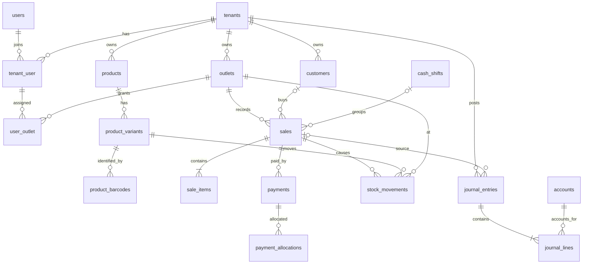

# Rancangan Database — R Kasir

**Basis rancangan:** PRD Platform Kasir & Manajemen Bisnis UMKM (R Tech), 48 halaman.  
**Target aplikasi:** Laravel 13, PWA offline-first, basis data relasional.  
**Status:** rancangan konseptual siap diturunkan menjadi migration; belum merupakan migration yang dijalankan.

## 1. Ringkasan keputusan desain

1. **Satu basis data transaksi bersama, multi-tenant secara logis.** Semua record bisnis mempunyai `tenant_id`; data yang spesifik lokasi juga mempunyai `outlet_id`. User dapat menjadi anggota beberapa tenant melalui tabel pivot.
2. **UUID pada semua ID yang dibuat/dikenali klien.** Perangkat bisa membuat transaksi ketika offline dan sinkronisasi tidak bergantung pada ID berurutan server. Gunakan UUIDv7 bila implementasi aplikasi konsisten mendukungnya; kolom dan validasi Laravel tetap bertipe UUID.
3. **Ledger sebagai sumber kebenaran.** Pergerakan stok dan jurnal akuntansi tidak diubah atau dihapus setelah diposting. Koreksi dibuat sebagai transaksi pembalik/penyesuaian baru. Tabel saldo adalah proyeksi untuk baca cepat, bukan sumber kebenaran.
4. **Pisahkan dokumen, fulfillment, pembayaran, dan akuntansi.** Satu pesanan dapat mempunyai beberapa surat jalan, faktur, dan pembayaran. Penjualan POS cepat dapat memakai dokumen penjualan langsung, tanpa memaksakan alur pesanan-kiriman.
5. **Simpan snapshot nilai saat transaksi.** Nama/sku produk, harga, pajak manual, diskon, HPP, identitas pelanggan, dan detail metode bayar yang relevan disalin ke baris transaksi. Perubahan katalog tidak boleh mengubah riwayat.
6. **Skema relasional yang portabel.** PostgreSQL direkomendasikan untuk produksi; rancangan tetap dapat dipetakan ke MySQL. Uang disimpan sebagai `DECIMAL(18,2)` (bukan float), kuantitas sebagai `DECIMAL(18,4)`, waktu dalam UTC dan tanggal bisnis mengikuti timezone outlet.
7. **Jangan membuat tabel untuk fitur spekulatif sebelum modul siap.** Struktur inti menyiapkan relasi untuk v1.1+, sedangkan payroll, cicilan syariah, marketplace, inbox, komunitas, domain, campaign, dan panel master dibangun sebagai bounded module berikutnya.

## 2. Cakupan dan pemetaan PRD

| Tahap | Kemampuan yang ditopang skema |
|---|---|
| MVP | Tenant/outlet/user/role, katalog dan barcode, POS, pembayaran tunai/transfer/QRIS/kasbon, shift kasir, stok, void/retur, pelanggan, sinkronisasi offline, audit, laporan dari data transaksi |
| v1.1 | Supplier, PO, penerimaan, tagihan/pembayaran supplier, invoice/DO/kwitansi, jurnal/COA/periode, aset, nomor seri dan garansi, resep bahan/menu, landing page dasar |
| v1.2+ | Piutang lebih lengkap, AI audit/draf, inbox/notifikasi, domain/SEO, sewa, cicilan, payroll, sosial/marketplace, komunitas, panel master, analytics terpisah |
| Di luar v1 | Pelaporan pajak resmi dan e-faktur; jangan memodelkan kewajiban pajak legal seolah sudah didukung |

Modul tambahan PRD tidak perlu mengubah model inti: transaksi, pelanggan, produk, outlet, ledger stok, pembayaran, akun, jurnal, dan audit tetap dipakai bersama.

## 3. ERD inti

ERD ini menampilkan jalur utama. Semua entitas operasional tambahan mengikuti tenant/outlet dan merujuk ke dokumen sumber yang sama.

## 4. Tabel dan kolom yang disarankan

Nama tabel menggunakan `snake_case`, bentuk jamak, dan nama domain yang jelas. Daftar kolom di bawah berfokus pada kolom bisnis, di luar `id`, timestamp standar, dan kolom audit umum.

### 4.1 Tenant, outlet, user, dan akses

| Tabel | Kolom utama dan catatan |
|---|---|
| `tenants` | `name`, `slug`, `business_type`, `legal_name` nullable, `phone`, `email`, `timezone` default `Asia/Jakarta`, `currency` default `IDR`, `status`, `settings` JSON untuk preferensi ringan/non-ledger, `created_by_user_id`. Tenant adalah satu usaha pelanggan dan batas isolasi wajib. |
| `outlets` | `tenant_id`, `name`, `code`, `address`, `phone`, `timezone`, `is_default`, `status`, `settings`. Unique `(tenant_id, code)`. MVP satu outlet; jangan menganggap semua tenant selalu satu outlet. |
| `users` | Akun login global: `name`, `email` nullable, `phone` nullable, `password`, `email_verified_at`, `phone_verified_at`, `two_factor_secret` nullable, `status`, `last_login_at`. Jangan taruh `tenant_id` tunggal di users. |
| `tenant_user` | `tenant_id`, `user_id`, `status`, `joined_at`, `invited_by_user_id`. Unique `(tenant_id,user_id)`. |
| `roles` | `tenant_id` nullable untuk role sistem, `name`, `key`, `description`, `is_system`. Contoh Owner, Manager, Cashier, Warehouse Admin. |
| `permissions` | `key`, `name`, `module`. Katalog permission bawaan. |
| `role_permissions` | `role_id`, `permission_id`; unique pasangan. |
| `tenant_user_roles` | `tenant_user_id`, `role_id`; role diberikan per tenant, bukan global user. |
| `user_outlet` | `tenant_user_id`, `outlet_id`, `is_default`, `status`; membatasi outlet yang boleh diakses. Kalau tenant_user berlaku untuk semua outlet, bisa ada flag eksplisit `all_outlets` dan tetap audit perubahan akses. |
| `tenant_settings` | Opsional bila pengaturan perlu tervalidasi/diindeks: `tenant_id`, `key`, `value` JSON, `updated_by_user_id`; unique `(tenant_id,key)`. Pengaturan yang berdampak ke saldo atau pengakuan transaksi sebaiknya kolom terstruktur/versioned, bukan JSON bebas. |

`tenant_id` tidak boleh dipercaya dari request klien. Ambil tenant aktif dari konteks keanggotaan terotorisasi, dan batasi query melalui tenant scope/policy. Untuk tabel anak, tetap simpan `tenant_id` agar query, indeks, audit, dan kontrol isolasi sederhana. Pastikan FK komposit dapat memastikan tenant parent sama jika mesin/strategi constraint memungkinkan.

### 4.2 Pelanggan, supplier, katalog, dan harga

| Tabel | Kolom utama dan catatan |
|---|---|
| `customers` | `tenant_id`, `code` nullable, `name`, `phone`, `email`, `address`, `notes`, `credit_limit` nullable, `is_active`, `deleted_at`. Nomor KTP/penghasilan jangan masuk tabel umum; simpan terpisah dan terenkripsi hanya jika fitur cicilan benar-benar dirilis. |
| `suppliers` | `tenant_id`, `code`, `name`, `contact_name`, `phone`, `email`, `address`, `payment_terms_days`, `notes`, `is_active`, `deleted_at`. |
| `product_categories` | `tenant_id`, `parent_id` nullable, `name`, `sort_order`, `is_active`. Hierarki kategori per tenant. |
| `products` | `tenant_id`, `category_id` nullable, `sku`, `name`, `description`, `product_type` (`stocked`, `service`, `bundle`), `base_unit_id`, `track_stock`, `allow_negative_stock`, `is_weighed`, `is_serialized`, `min_stock` nullable, `is_favorite`, `is_active`, `deleted_at`. Unique `(tenant_id,sku)`; sku sistem unik per tenant. |
| `product_variants` | `tenant_id`, `product_id`, `name`/`variant_label`, `sku`, `attributes` JSON untuk atribut varian (warna/ukuran), `cost_price` (nilai acuan saja), `is_active`. Untuk produk tanpa varian, buat satu varian default; stok dan barcode menempel ke varian agar seragam. |
| `units` | `tenant_id` nullable untuk satuan global, `name`, `symbol`, `precision`. |
| `product_unit_conversions` | `tenant_id`, `product_id`, `unit_id`, `base_quantity` (contoh 1 dus = 12 pcs), `is_purchase_unit`, `is_sell_unit`. Hindari konversi melingkar; kuantitas ledger selalu disimpan dalam satuan dasar. |
| `product_barcodes` | `tenant_id`, `product_variant_id`, `unit_id` nullable, `barcode`, `type`, `is_primary`. Unique `(tenant_id, barcode)` bila aturan bisnis melarang barcode sama pada beberapa produk; jika tidak, validasi keunikan sesuai lingkup katalog. Mendukung banyak kode per varian/satuan. |
| `product_prices` | `tenant_id`, `product_variant_id`, `outlet_id` nullable untuk harga default tenant, `price_type` (retail/wholesale/custom), `unit_id`, `price`, `valid_from`, `valid_until` nullable, `is_active`. Harga transaksi tetap disalin ke `sale_items`. |
| `bundle_components` | `tenant_id`, `bundle_variant_id`, `component_variant_id`, `quantity` dalam satuan dasar. Versi komposisi/efektif tanggal diperlukan bila bundel berubah dan riwayat harus direproduksi. |
| `recipes` / `recipe_items` | v1.1 FnB: resep/menu ke bahan, kuantitas dasar, yield/version. Saat menu dijual, posting mutasi konsumsi bahan memakai versi resep yang efektif ketika transaksi. |

### 4.3 POS, dokumen penjualan, dan shift

| Tabel | Kolom utama dan catatan |
|---|---|
| `cash_shifts` | `tenant_id`, `outlet_id`, `cashier_user_id`, `opened_at`, `opening_cash`, `closed_at` nullable, `expected_cash` nullable, `counted_cash` nullable, `cash_difference` nullable, `status`, `open_device_id` nullable, `close_note`. Satu shift aktif per kasir/outlet (tegakkan transaksi/lock; partial unique index khusus PostgreSQL bila dipakai). |
| `sales` | Dokumen POS: `tenant_id`, `outlet_id`, `cash_shift_id` nullable, `customer_id` nullable, `sale_number`, `client_transaction_id` UUID, `status` (`draft`, `held`, `pending_payment`, `completed`, `voided`, `partially_returned`, `returned`), `channel` (`pos`, `web`, `marketplace`, `other`), `sold_at`, `currency`, `subtotal`, `discount_total`, `fee_total`, `tax_total` manual nullable, `grand_total`, `paid_total`, `change_total`, `notes`, `created_by_user_id`, `completed_at`, `voided_at`, `voided_by_user_id`, `void_reason`, `source` nullable. Unique `(tenant_id,outlet_id,sale_number)` dan unique idempotensi `(tenant_id,client_transaction_id)`. `sale_number` offline: perangkat minta/reserve range atau nomor lokal berprefix device; jangan mengandalkan jam saja. |
| `sale_items` | `tenant_id`, `sale_id`, `product_id` nullable untuk snapshot/hapus katalog, `product_variant_id` nullable, `sku_snapshot`, `name_snapshot`, `variant_snapshot`, `unit_id`, `quantity`, `base_quantity`, `unit_price`, `discount_type`, `discount_value`, `discount_amount`, `tax_rate` nullable, `tax_amount`, `unit_cost_snapshot`, `line_subtotal`, `line_total`, `note`, `line_type`. HPP snapshot dipakai untuk jurnal HPP sesuai kebijakan costing. |
| `sale_adjustments` | `tenant_id`, `sale_id`, `type` (discount/fee/manual_tax), `label`, `calculation_method`, `rate` nullable, `amount`. Diskon dan biaya tingkat transaksi disimpan eksplisit agar dapat direkonsiliasi. |
| `payments` | Catatan tender/percobaan pembayaran: `tenant_id`, `outlet_id`, `customer_id` nullable, `sale_id` nullable, `invoice_id` nullable, `payment_number`, `method` (`cash`,`bank_transfer`,`qris_external`,`qris_gateway`,`credit`,`other`), `status` (`pending`,`confirmed`,`settled`,`failed`,`expired`,`refunded`,`reversed`), `amount`, `received_at` nullable, `confirmed_at` nullable, `settled_at` nullable, `cash_account_id` nullable, `provider`, `provider_reference` nullable, `idempotency_key`, `confirmed_by_user_id`, `metadata` JSON terbatas. Unique provider reference dalam scope provider/tenant bila tidak null. Jangan simpan credential/payment card. |
| `payment_allocations` | `tenant_id`, `payment_id`, `sale_id` nullable, `invoice_id` nullable, `amount`. Memungkinkan pembayaran dipecah dan dialokasikan ke dokumen; validasi hanya satu target per baris dan jumlah alokasi tidak melampaui pembayaran. Hindari menyimpan `sale_id` hanya di payments jika satu pembayaran bisa melunasi beberapa invoice. |
| `payment_events` | `tenant_id`, `payment_id`, `provider_event_id`, `event_type`, `received_at`, `payload_hash`, `verification_status`, `processed_at`, `error_code`. Unique `(provider,provider_event_id)` untuk webhook idempoten. Payload penuh yang memuat data pribadi hanya disimpan bila perlu dan dengan retensi terbatas. |
| `sale_returns` | `tenant_id`, `outlet_id`, `sale_id`, `return_number`, `status`, `reason`, `returned_at`, `created_by_user_id`, `approved_by_user_id`, `refund_total`, `restock_policy`. Dokumen baru; jangan edit sale selesai untuk menggambarkan retur. |
| `sale_return_items` | `tenant_id`, `sale_return_id`, `sale_item_id`, `product_variant_id`, `quantity`, `condition`, `restock_quantity`, `refund_amount`, `reason`. Mutasi stok dan refund berasal dari baris retur saat diposting. |
| `document_counters` | `tenant_id`, `outlet_id` nullable, `document_type`, `period_key`, `prefix`, `next_number`, `padding`. Lock baris di transaksi saat menerbitkan nomor invoice/DO/PO. Dokumen yang terbit tidak dihapus; batal dengan status dan alasan. |

Tahan transaksi boleh memakai `sales.status=held` atau tabel draft terpisah bila banyak metadata keranjang perlu disimpan. Hold belum mem-posting pembayaran final, mutasi stok final, atau jurnal penjualan.

### 4.4 Pesanan, surat jalan, faktur, dan piutang

Gunakan `sales` sebagai dokumen penjualan cepat POS, tetapi dokumen pengiriman/invoice formal memakai domain order agar satu pesanan bisa dipenuhi sebagian dan difaktur secara fleksibel.

| Tabel | Kolom utama dan catatan |
|---|---|
| `sales_orders` | `tenant_id`, `outlet_id`, `customer_id`, `order_number`, `status`, `ordered_at`, `delivery_address_snapshot`, `subtotal`, `discount_total`, `shipping_fee`, `total`, `notes`, `created_by_user_id`. |
| `sales_order_items` | `tenant_id`, `sales_order_id`, `product_variant_id`, snapshot nama/SKU, `ordered_quantity`, `unit_price`, `discount_amount`, `line_total`, `unit_id`. |
| `delivery_notes` | `tenant_id`, `outlet_id`, `sales_order_id`, `delivery_number`, `status`, `shipped_at`, `recipient_name`, `carrier`, `tracking_number`, `delivery_address_snapshot`, `proof_received_at`, `created_by_user_id`, `cancel_reason`. |
| `delivery_note_items` | `tenant_id`, `delivery_note_id`, `sales_order_item_id`, `product_variant_id`, snapshot nama/SKU, `quantity`. Penerbitan/pengiriman adalah trigger domain untuk posting mutasi stok sesuai policy tenant. |
| `invoices` | `tenant_id`, `outlet_id`, `customer_id`, `sales_order_id` nullable, `invoice_number`, `status`, `issued_at`, `due_at`, snapshot identitas usaha dan pelanggan, `subtotal`, `discount_total`, `shipping_fee`, `manual_tax_total`, `total`, `paid_total`, `balance_due`, `canceled_at`, `cancel_reason`. Invoice dapat menggabungkan item beberapa delivery notes; hubungkan lewat pivot. |
| `invoice_items` | `tenant_id`, `invoice_id`, `sales_order_item_id` nullable, `product_variant_id` nullable, snapshot nama/SKU/unit, `quantity`, `unit_price`, `discount_amount`, `cost_snapshot`, `line_total`. |
| `invoice_delivery_notes` | `tenant_id`, `invoice_id`, `delivery_note_id`; unique pasangan. Mendukung beberapa pengiriman per invoice dan satu pengiriman difaktur sebagian bila aturan bisnis membutuhkannya. |
| `receipts` | `tenant_id`, `outlet_id`, `invoice_id` nullable, `payment_id`, `receipt_number`, `issued_at`, `amount`, `snapshot` JSON terkontrol. Kwitansi adalah bukti penerimaan dana; payment adalah data finansial sumber. |
| `document_templates` | `tenant_id`, `document_type`, `name`, `settings` JSON tervalidasi (logo, syarat, footer, tanda tangan), `is_default`. File logo/lampiran simpan di object storage; database simpan path dan metadata. |
| `document_files` | `tenant_id`, `document_type`, `document_id`, `file_id`, `purpose` (PDF/proof/photo/attachment), `uploaded_by_user_id`. Jika polymorphic, batasi type melalui enum aplikasi dan validasi tenant. |

Kebijakan kapan stok keluar (`on_delivery` atau `on_invoice`) adalah setting tenant yang terversi. Jangan membuat mutasi stok dua kali jika dokumen ditautkan silang.

### 4.5 Stok, penerimaan, pembelian, dan supplier payable

| Tabel | Kolom utama dan catatan |
|---|---|
| `stock_movements` | Ledger append-only: `id` UUID, `tenant_id`, `outlet_id`, `product_variant_id`, `occurred_at`, `movement_type` (sale/return/purchase/transfer/adjustment/count/recipe/asset), `quantity_delta` (satuan dasar; plus/minus), `unit_cost`, `value_delta`, `source_type`, `source_id`, `source_line_id` nullable, `idempotency_key`, `created_by_user_id`, `device_id`, `reason`. Unique `(tenant_id,idempotency_key)` bila tersedia. Baris ledger yang diposting tidak di-update/delete; koreksi dengan movement lawan. |
| `stock_balances` | Proyeksi untuk performa: `tenant_id`, `outlet_id`, `product_variant_id`, `quantity_on_hand`, `inventory_value`, `average_cost`, `updated_at`, `version`. Unique pasangan `(tenant_id,outlet_id,product_variant_id)`. Perbarui atomik/lock dari ledger, dapat dibangun ulang. |
| `stock_reservations` | v1.1+ bila perlu: `tenant_id`, `outlet_id`, `product_variant_id`, `source_type/id`, `quantity`, `status`, `expires_at`; untuk pesanan menunggu pembayaran/fulfillment. Aturan PRD menyebut QRIS belum lunas tidak mengurangi stok final; reservation opsional dan terpisah dari on-hand. |
| `stock_counts` | `tenant_id`, `outlet_id`, `count_number`, `status`, `started_at`, `submitted_at`, `approved_at`, `approved_by_user_id`, `notes`. |
| `stock_count_items` | `tenant_id`, `stock_count_id`, `product_variant_id`, `system_quantity_snapshot`, `counted_quantity`, `variance`, `unit_cost_snapshot`, `note`. Approval membuat movement adjustment; draf opname tidak mengubah saldo. |
| `suppliers` | Didefinisikan di katalog; relasi ke purchase orders dan bills. |
| `purchase_orders` | `tenant_id`, `outlet_id`, `supplier_id`, `po_number`, `status`, `ordered_at`, `needed_at`, `subtotal`, `discount_total`, `total`, `approved_by_user_id`, `sent_at`, `cancel_reason`, `created_by_user_id`. |
| `purchase_order_items` | `tenant_id`, `purchase_order_id`, `product_variant_id`, snapshot nama/SKU, `ordered_quantity`, `unit_id`, `unit_cost`, `received_quantity`, `line_total`. |
| `goods_receipts` | `tenant_id`, `outlet_id`, `purchase_order_id` nullable (pembelian cepat), `receipt_number`, `status`, `received_at`, `supplier_id`, `created_by_user_id`, `notes`. |
| `goods_receipt_items` | `tenant_id`, `goods_receipt_id`, `purchase_order_item_id` nullable, `product_variant_id`, `quantity`, `unit_cost`, `base_quantity`, `condition`, `lot_reference` nullable. Saat diposting membuat stock movements. |
| `supplier_bills` | `tenant_id`, `outlet_id`, `supplier_id`, `purchase_order_id` nullable, `bill_number`, `supplier_invoice_number`, `status`, `billed_at`, `due_at`, `subtotal`, `discount_total`, `total`, `paid_total`, `balance_due`. Stok diterima dan tagihan supplier adalah kejadian terpisah. |
| `supplier_bill_items` | `tenant_id`, `supplier_bill_id`, `goods_receipt_item_id` nullable, `product_variant_id` nullable, description snapshot, `quantity`, `unit_cost`, `line_total`. |
| `supplier_payments` | Lebih baik gunakan `payments` + `payment_allocations` dengan tipe target payable; jika ingin FK kuat, buat `supplier_payment_allocations(payment_id,supplier_bill_id,amount)`. Pembayaran sebagian didukung. |
| `purchase_returns` / `purchase_return_items` | Dokumen retur supplier, refer ke receipt/item asli, kuantitas dan kredit hutang; posting membuat movement negatif dan jurnal/pengurangan payable. |

Mutasi `sale` hanya dibuat ketika penjualan benar-benar selesai/terkonfirmasi. Pembayaran pending QRIS tidak memicu sale final, stok final, atau laporan penjualan lunas. Bila usaha memilih boleh stok negatif, movement tetap tercatat dan saldo negatif dibolehkan oleh policy, bukan dengan menghilangkan ledger.

### 4.6 Pembukuan double-entry

| Tabel | Kolom utama dan catatan |
|---|---|
| `chart_of_accounts` | `tenant_id`, `code`, `name`, `account_type`, `normal_balance`, `parent_id`, `is_system`, `is_active`, `allow_manual_posting`. COA seed berdasar template usaha, lalu disalin/dikelola per tenant. |
| `accounting_periods` | `tenant_id`, `starts_on`, `ends_on`, `status` (`open`,`closed`), `closed_at`, `closed_by_user_id`, `reopened_at`, `reopened_by_user_id`, `close_note`. Unique `(tenant_id,starts_on,ends_on)`. |
| `journal_entries` | `tenant_id`, `outlet_id` nullable (jurnal usaha-level bisa null), `entry_number`, `entry_date`, `status` (`draft`,`posted`,`reversed`), `description`, `source_type`, `source_id`, `idempotency_key`, `posted_at`, `posted_by_user_id`, `reversal_of_entry_id` nullable, `created_by_user_id`. Unique idempotency key. Posted entry tidak diedit/dihapus; koreksi lewat reversal dan entry baru. |
| `journal_lines` | `tenant_id`, `journal_entry_id`, `account_id`, `description`, `debit`, `credit`, `customer_id` nullable, `supplier_id` nullable, `product_variant_id` nullable, `outlet_id` nullable. Constraint aplikasi/database: satu sisi positif per baris dan total debit=total credit sebelum posting. Jangan simpan debit/kredit negatif. |
| `accounting_events` | `tenant_id`, `source_type`, `source_id`, `event_type`, `status`, `posted_entry_id` nullable, `idempotency_key`, `error`. Outbox/jejak pemrosesan agar kejadian bisnis dan posting jurnal dapat diulang idempoten. |
| `expenses` / `expense_items` | Form pengeluaran sederhana dengan `tenant_id`, `outlet_id`, `expense_number`, `spent_at`, vendor/deskripsi, akun biaya, metode bayar, total, lampiran. Posting membentuk payment dan journal; hindari jurnal langsung yang tidak punya dokumen sumber. |
| `cash_accounts` | `tenant_id`, `outlet_id` nullable, `name`, `type` (`cash`,`bank`,`qris_clearing`,`gateway_receivable`,`marketplace_receivable`), `provider`, `account_id` nullable, `is_active`. Akun kas/bank operasional terhubung ke COA. |
| `cash_account_transactions` | Opsional sebagai proyeksi/statement ledger; sumber akuntansi tetap `journal_lines`. Gunakan hanya jika butuh rekonsiliasi saldo kas/bank operasional yang lebih mudah. |

Aturan jurnal otomatis dibentuk oleh service posting terpusat dari event bisnis, bukan observer Eloquent yang tersembunyi. Contoh pasangan: penjualan tunai debit Kas/kredit Penjualan; HPP debit HPP/kredit Persediaan; QRIS belum settlement debit Piutang Gateway/kredit Penjualan, lalu settlement debit Bank/kredit Piutang Gateway; penerimaan barang kredit Hutang Usaha; pembayaran hutang debit Hutang Usaha/kredit Kas/Bank. Rincian akun dan kapan pendapatan diakui harus direview akuntan sebelum produksi.

### 4.7 Sinkronisasi offline, idempotensi, audit, dan file

| Tabel | Kolom utama dan catatan |
|---|---|
| `devices` | `tenant_id`, `outlet_id`, `device_uuid`, `name`, `platform`, `last_seen_at`, `revoked_at`, `registered_by_user_id`. UUID perangkat tetap, token rahasia disimpan hash. |
| `sync_operations` | `tenant_id`, `device_id`, `operation_uuid`, `aggregate_type`, `aggregate_uuid`, `operation_type`, `payload_version`, `payload_hash`, `status`, `received_at`, `processed_at`, `error_code`, `server_version`. Unique `(tenant_id,device_id,operation_uuid)`. Hindari payload sensitif penuh di log; gunakan payload tersimpan terenkripsi/retensi pendek bila diperlukan. |
| `sync_cursors` | `tenant_id`, `device_id`, `stream`, `last_server_sequence`, `updated_at`. Untuk unduh perubahan incremental. |
| `audit_logs` | Append-only: `tenant_id`, `outlet_id` nullable, `actor_user_id`, `device_id` nullable, `action`, `subject_type`, `subject_id`, `before` JSON, `after` JSON, `reason`, `ip_address`, `occurred_at`, `request_id`. Batasi data pribadi dalam before/after; log sensitif dienkripsi dan punya retensi jelas. |
| `files` | Metadata file: `tenant_id`, `disk`, `path`, `original_name`, `mime_type`, `size`, `checksum`, `uploaded_by_user_id`, `visibility`, `encrypted_at_rest`. File berada di object storage privat; akses melalui signed URL/policy, bukan path publik tebakan. |
| `outbox_messages` | `tenant_id`, `aggregate_type/id`, `event_type`, `payload`, `occurred_at`, `published_at`, `attempts`, `last_error`. Menjamin perubahan database dan event queue konsisten. |

Strategi konflik: transaksi yang berbeda dari beberapa perangkat tetap diterima karena UUID; replay operasi yang sama ditolak melalui idempotency key. Untuk stok, sinkronkan movement, bukan menimpa `stock_balances`. Nomor invoice/DO server dibuat saat penerbitan online dengan counter terkunci; dokumen draft offline belum dianggap terbit resmi. Jika POS harus mencetak offline, gunakan nomor sementara device-local dan simpan nomor resmi saat sync dengan pemetaan yang terlihat.

## 5. Relasi lintas modul v1.2+

Skema berikut sengaja ringkas sebagai rancangan tahap berikutnya; implementasikan saat prioritasnya tervalidasi.

| Modul | Entitas utama yang disarankan |
|---|---|
| Serial/garansi elektronik | `serial_units(tenant_id, product_variant_id, serial_number, status)`, `serial_unit_events`, `warranties(sale_item_id, serial_unit_id, customer_id, starts_at, ends_at, terms_snapshot)`, `service_cases`, `service_case_events`. Unique serial dalam tenant. |
| Aset/perawatan/penyusutan | `business_assets`, `asset_events`, `asset_maintenance_schedules`, `asset_maintenance_records`, `asset_depreciation_schedules`, `asset_disposals`; pembelian terhubung ke penerimaan, jurnal lewat event. Jangan campur aset dengan barang persediaan. |
| Sewa alat | `rental_bookings`, `rental_contracts`, `rental_items`, `rental_returns`, `rental_condition_checks`, `rental_charges`, `rental_deposits`; kalender availability perlu transaksi/lock agar booking bentrok tidak lolos. Deposit adalah liabilitas hingga diselesaikan. |
| Cicilan murabahah | `financing_applications`, `financing_contracts`, `financing_installments`, `financing_payments`, `financing_restructures`, `financing_penalties`. Snapshot akad/margin/jadwal terkunci; aturan perlu review ahli syariah dan legal. Identitas/penghasilan terenkripsi dan akses sangat dibatasi. |
| Karyawan/payroll | `employees`, `employee_compensation_versions`, `attendance_records`, `payroll_runs`, `payroll_items`, `payroll_components`, `payroll_component_lines`, `payroll_deductions`; tarif peraturan sebagai data berversi, bukan nilai hard-code. Batasi akses dan audit. |
| Marketplace | `channel_accounts` (credential terenkripsi), `channel_product_mappings`, `channel_orders`, `channel_order_items`, `channel_settlements`, `channel_fees`, `integration_webhook_events`, `sync_jobs`. Harga/stock buffer per kanal dipisah dari saldo stok utama. |
| Sosial/iklan/inbox | `social_accounts`, `campaigns`, `scheduled_posts`, `post_publications`, `conversations`, `messages`, `conversation_assignments`, `webhook_events`, `ad_accounts`, `ad_campaigns`. OAuth token terenkripsi; pesan punya retensi dan jendela kanal. |
| Landing page/domain | `storefronts`, `storefront_pages`, `storefront_blocks`, `custom_domains`, `domain_events`, `page_analytics_daily`. Jangan menjalankan HTML/CSS mentah tanpa sanitasi. |
| Komunitas | Forum sebaiknya dibeli/diintegrasikan di awal sesuai PRD; jika dibuat sendiri: `community_users` via SSO, `topics`, `posts`, `answers`, `reactions`, `reports`, `moderation_actions`, `resources`. Bukan bagian transaksi tenant. |
| Panel master R Tech | Pisahkan identitas staf platform dan audit platform dari akun tenant. `platform_users`, `platform_roles`, `platform_audit_logs`, `support_tickets`, `tenant_subscriptions`, `feature_entitlements`, `usage_daily_aggregates`. Akses default agregat; jangan menyalin detail transaksi ke analytics. |
| AI | `ai_requests`, `ai_usage_ledger`, `ai_drafts`, `ai_approvals`; simpan referensi sumber/metrik dan status persetujuan manusia, hindari menyimpan prompt yang memuat PII lebih lama dari perlu. |

## 6. Indeks, constraint, dan aturan integritas

- Semua tabel tenant: indeks dimulai dengan `tenant_id`; tabel outlet juga indeks `(tenant_id,outlet_id,...)`.
- Unique penting: `(tenant_id, outlet_id, sale_number)`, `(tenant_id,sku)`, `(tenant_id,document_type,period_key)` di counter, `(tenant_id,device_id,operation_uuid)`, idempotency payment/webhook, serta unique barcode yang disepakati.
- FK eksplisit dengan kebijakan penghapusan **restrict** pada dokumen finansial/ledger. Soft delete hanya untuk master data jika referensi historis tetap sah; jangan soft delete transaksi posted seolah lenyap.
- Dokumen finansial memiliki status dan timestamp posting. Validasi transisi status lewat domain service; status bukan sekadar kolom bebas yang diubah controller.
- Kuantitas memakai decimal presisi 4 atau lebih sesuai timbangan; harga uang decimal 2 (IDR). Simpan metode pembulatan dan distribusi diskon untuk rekonsiliasi per item.
- Semua nilai transaksi menyimpan `currency` (MVP hanya IDR) agar format jelas; jangan mengaktifkan multi-currency tanpa model kurs/revaluasi.
- Snapshot nama, alamat, SKU, harga, akun, pajak manual, syarat dokumen, dan metode bayar mencegah data master baru mengubah dokumen lama.
- Pembayaran QRIS: verify signature dan amount/reference dari provider, simpan ID event unik, proses callback dalam transaksi DB, jangan percaya nilai status dari browser.
- Constraint lintas baris (debit=credit, total alokasi, tidak melebihi qty order) divalidasi sebelum commit di service; pertimbangkan deferred constraint/trigger hanya setelah target DB dipastikan.
- Report harian/bulanan dapat memakai tabel ringkasan/cache yang bisa direbuild dari ledger, bukan mengubah ledger demi performa.

## 7. Konvensi implementasi Laravel 13

- Gunakan migration berurutan per domain: `identity`, `catalog`, `sales`, `inventory`, `purchasing`, `accounting`, `sync`, kemudian add-on. Pisahkan migration foundational dari migration fitur agar urutan FK jelas.
- Pakai UUID primary key (`$table->uuid('id')->primary()`) dan `foreignUuid` konsisten; UUIDv7 dapat dibuat di aplikasi bila versi library yang dipakai mendukungnya. Pastikan klien menghasilkan ID valid dan server tidak mengganti ID record saat sinkron.
- Hindari polymorphic relation untuk relasi uang/stok yang wajib kuat kecuali memang perlu. Bila `source_type/source_id` dipakai di ledger untuk banyak jenis dokumen, enforce referential integrity dalam domain service dan simpan `source_line_id`/UUID idempotensi.
- Definisikan enum status di PHP backed enum/domain constants, tetapi simpan string varchar tervalidasi untuk memudahkan migrasi status. Jangan pakai MySQL ENUM yang menyulitkan evolusi.
- `tenant_id`, `outlet_id`, `created_by_user_id`, `posted_by_user_id` eksplisit, bukan hanya trait ajaib. Buat tenant context middleware, policy, query scopes, dan pengujian isolasi tenant sebagai bagian dari desain aplikasi.
- Gunakan `DB::transaction()` untuk posting dokumen bersama movement/payment/journal, lalu tulis event outbox di transaksi yang sama. Listener antrean memproses tugas eksternal idempoten.
- Append-only ledger ditopang oleh larangan update/delete di service/model, policy database bila memungkinkan, audit, dan prosedur koreksi reversal.
- JSON hanya untuk atribut dinamis, metadata integrasi, dan konfigurasi tampilan yang tervalidasi. Kolom yang dipakai filter, agregasi, relasi, atau jurnal harus kolom relasional.
- Dokumentasi resmi Laravel 13 mendukung migration Schema dan tipe `uuid`/`ulid`; pilih UUID karena PRD mensyaratkan ID perangkat untuk transaksi offline dan UUID mudah dibuat lintas klien. Laravel juga mendukung beberapa database relasional, tetapi target DB produksi perlu diputuskan sebelum menulis constraint spesifik. [Laravel 13 migrations](https://laravel.com/framework/docs/13.x/migrations) · [Laravel database](https://laravel.com/framework/docs/database)

## 8. Urutan migration yang disarankan

1. `users`, `tenants`, `outlets`, `tenant_user`, `roles`, `permissions`, pivot akses.
2. `customers`, `suppliers`, `units`, `product_categories`, `products`, `product_variants`, barcode, harga, unit conversion.
3. `devices`, `cash_shifts`, document counters, `sales`, items, adjustments, payments, payment allocations/events.
4. `stock_movements`, `stock_balances`, stock count dan return; setelah sales/purchase source tersedia, gunakan FK yang dapat dibentuk tanpa siklus atau source registry yang disengaja.
5. `sales_orders`, deliveries, invoices, receipts, file/document attachments.
6. `purchase_orders`, receipts barang, bills, payments payable allocations, purchase returns.
7. COA, accounting periods, journal entries/lines, accounting events, expenses.
8. Audit, sync operations/cursors, outbox, dan report aggregates.
9. Add-on hanya ketika mulai dikerjakan; buat migration tersendiri per modul.

Untuk menghindari siklus FK, ledger boleh merujuk `source_type/source_id` terkontrol aplikasi, sementara tabel dokumen merujuk FK normal ke tenant, outlet, customer, product, dan pengguna. Alternatif yang lebih ketat adalah `business_documents` sebagai registry ID lintas dokumen; pilih satu pola dan konsisten.

## 9. Contoh alur posting yang jadi acuan

### Penjualan tunai POS

1. Simpan `sales` + `sale_items` dan tender cash dalam satu transaksi DB setelah validasi shift/harga/izin.
2. Kunci saldo produk per outlet dan hitung HPP berdasarkan metode costing yang dipilih.
3. Buat `stock_movements` negatif per item; update proyeksi `stock_balances` atomik.
4. Buat journal entry debit Kas, kredit Penjualan; entry kedua debit HPP, kredit Persediaan.
5. Tandai sale completed, simpan audit/outbox. Jika satu langkah gagal, rollback semua.

### QRIS gateway

1. Buat payment pending; jangan finalkan sale atau stok.
2. Webhook diverifikasi, catat event unik di `payment_events`.
3. Saat sukses: payment confirmed/settled sesuai status provider, alokasikan ke sale/invoice, finalkan penjualan dan stok sesuai aturan PRD, buat jurnal clearing.
4. Saat settlement provider masuk bank, posting transfer dari akun piutang gateway ke bank; callback duplikat tidak membuat posting kedua.

### Barang PO diterima sebagian

1. Simpan `goods_receipt` dan item terhadap baris PO; kurangi remaining quantity, tetapi PO tetap status partial.
2. Posting mutasi stok positif dan perbarui moving average cost.
3. Ketika supplier bill diterima, buat payable sesuai penerimaan/faktur; pembayaran dapat dibagi beberapa kali melalui allocation.

### Void/retur

Dokumen completed tidak dihapus. Void sebelum pemenuhan dan retur setelah penjualan memakai dokumen pembalik dengan alasan, pemilik/pihak berwenang, timestamp, mutasi stok kebalikan (untuk barang yang restock), refund/reversal pembayaran, dan jurnal reversal. Aksi sensitif wajib tercatat di audit.

## 10. Asumsi dan keputusan yang masih perlu dikunci

1. **Database produksi:** rekomendasi PostgreSQL; PRD membuka PostgreSQL atau MySQL. Putuskan sebelum migration final karena partial unique index, JSON/query, dan constraint tertentu berbeda.
2. **ID offline dan nomor transaksi:** UUID untuk ID record ditetapkan desain. Format nomor yang unik offline perlu keputusan UX/operasional: nomor sementara per perangkat lalu nomor resmi server, atau server reserve range saat perangkat online.
3. **Waktu pengurangan stok penjualan:** POS saat pembayaran terkonfirmasi; pesanan kirim berdasarkan setting tenant (`on_delivery` default atau `on_invoice`). QRIS pending tidak dianggap penjualan lunas. Jika perlu mencegah oversell, reservation menjadi stok terpisah.
4. **Costing:** PRD memilih moving average; tentukan perlakuan pembelian retroaktif, retur, stok negatif, serta koreksi HPP setelah biaya faktur berbeda dari penerimaan.
5. **Split tender dan piutang:** satu transaksi boleh punya beberapa payment/allocation; kasbon adalah saldo piutang, bukan metode tender yang dianggap uang diterima.
6. **Pembatalan dan periode tutup:** aturan otorisasi PIN, batas waktu void, approval, reopen periode, dan tanggal jurnal harus dikunci bersama akuntan.
7. **Tenant vs outlet:** user terhubung ke tenant dan outlet melalui pivot; kebijakan katalog/harga lintas outlet perlu ditentukan (default tenant atau override outlet).
8. **Pajak:** hanya kolom persentase manual/dokumen internal sesuai PRD; jangan menjanjikan kepatuhan pajak formal.
9. **PDP/retensi:** jadwal retensi untuk transaksi yang wajib disimpan, permintaan ekspor/hapus, file bukti, webhook, audit log, payroll, dan identitas cicilan perlu kebijakan terpisah.

## 11. Rekomendasi urutan implementasi

1. Sepakati PostgreSQL/MySQL, aturan ID/nomor offline, tenant/outlet, dan policy stok/HPP.
2. Implementasi fondasi tenant, akses, catalog, barcodes, device/sync idempotency.
3. Implementasi sale/POS, shift, split payments, stock ledger dan laporan dasar.
4. Tambahkan retur/void, QRIS webhook, audit, rekonsiliasi stok dan jurnal otomatis dasar.
5. Baru lanjut PO/penerimaan/payable, invoice/DO/receipts, COA/journal/period lock.
6. Rilis add-on satu per satu sesuai tahap PRD; jangan memasukkan payroll/cicilan/marketplace ke tabel serbaguna `settings` atau `metadata`.

Rancangan ini diturunkan dari kebutuhan dan prioritas di PRD; istilah yang berbunyi seperti instruksi operasional di dalam dokumen diperlakukan sebagai isi spesifikasi produk, bukan perintah untuk menjalankan tindakan di luar permintaan pengguna.
